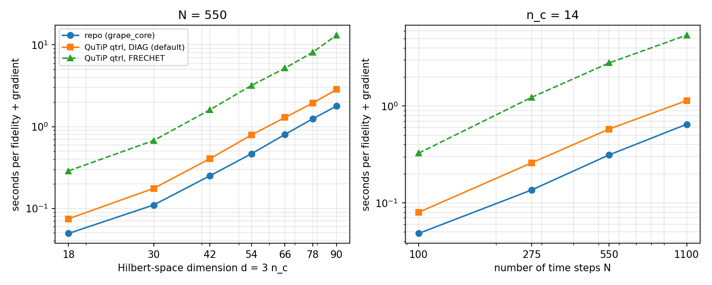
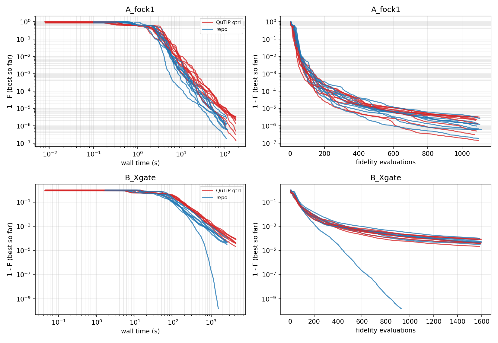

# Repo GRAPE vs QuTiP GRAPE: benchmark results

This folder compares the repo's closed-system GRAPE (`core/grape_core.py` + scipy L-BFGS-B) with QuTiP's GRAPE (the `qutip-qtrl` package, unitary dynamics). Both get the same transmon-cavity Hamiltonian, the same 2 ns piecewise-constant time steps and the same targets. QuTiP's default propagator (`DIAG`) also uses an eigendecomposition and an exact gradient, so the two codes do the **same maths**: what differs is how it is implemented. Generated by `python QuTip/benchmark_qtrl.py report`; do not edit by hand.

**Machine:** platform Windows-10-10.0.26200-SP0, processor Intel64 Family 6 Model 183 Stepping 1, GenuineIntel, cpu_count 24, python 3.9.13, numpy 1.26.4, scipy 1.11.4, qutip 5.0.4, qutip_qtrl 0.2.0, blas openblas, blas_threads 1

**Fidelity convention.** All fidelities are the repo's F = |sum_m <f_m|U|i_m>|^2 / k^2 (k = number of input states; k = 1 for the Fock problem, k = 2 for the cat-code X gate). QuTiP's phase-insensitive fidelity is f = |Tr(W^dag U V)| / k, so F = f^2.

## Summary

- **B1 same physics:** largest |F_repo - F_QuTiP| = 1.5e-13 over 11 pulses (2.2e-08 with QuTiP's default single-precision time steps).
- **B2 gradients:** largest error against finite differences: repo 6.9e-07, QuTiP DIAG 6.9e-07, QuTiP FRECHET 6.9e-07.
- **B3 cost per evaluation:** QuTiP DIAG takes 1.51 to 1.70 times as long as the repo (n_c 6 to 30, N 550); QuTiP FRECHET 5.8 to 7.4 times.
- **B4 A_fock1:** median time to 1 - F <= 1e-3: repo 11.1 s, QuTiP 16.4 s; median final F repo 0.999999, QuTiP 0.999998.
- **B4 B_Xgate:** median time to 1 - F <= 1e-3: repo 664 s, QuTiP 1.11e+03 s; median final F repo 0.999952, QuTiP 0.999956.

## B1. Same physics: do both codes give the same fidelity for the same pulse?

*Why:* every speed or convergence comparison below only means something if both codes solve exactly the same problem (same Hamiltonian, operator ordering, time stepping and fidelity). *What it measures:* the fidelity of fixed pulses (random smooth pulses and the production pulse `pulses/u_X_main.npy`) computed by each code. *Pass:* differences at rounding level (about 1e-10 or less).

| problem | n_c | N | pulse | F_repo | F_qutip | abs_diff | abs_diff_float32_tau |
|---|---|---|---|---|---|---|---|
| X | 22 | 550 | random_s1 | 0.105765843369 | 0.105765843369 | 1.4e-15 | 3.7e-09 |
| X | 22 | 550 | random_s2 | 0.002695204798 | 0.002695204798 | 1.5e-16 | 4.1e-09 |
| X | 22 | 550 | random_s3 | 0.004088144066 | 0.004088144066 | 2.6e-15 | 1.4e-08 |
| X | 22 | 550 | u_X_main.npy | 0.998534759108 | 0.998534759107 | 1.5e-13 | 4.2e-10 |
| X | 26 | 550 | random_s1 | 0.105765985626 | 0.105765985626 | 3.8e-15 | 3.7e-09 |
| X | 26 | 550 | random_s2 | 0.002695197246 | 0.002695197246 | 4.1e-16 | 4.1e-09 |
| X | 26 | 550 | random_s3 | 0.004088233611 | 0.004088233611 | 1.2e-15 | 1.4e-08 |
| X | 26 | 550 | u_X_main.npy | 0.998540299779 | 0.998540299779 | 1.3e-14 | 4.2e-10 |
| fock1 | 10 | 250 | random_s1 | 0.193652336938 | 0.193652336938 | 1.8e-14 | 8.6e-09 |
| fock1 | 10 | 250 | random_s2 | 0.221647780673 | 0.221647780673 | 1.9e-14 | 9.2e-09 |
| fock1 | 10 | 250 | random_s3 | 0.117725377199 | 0.117725377199 | 1.5e-15 | 2.2e-08 |

`abs_diff_float32_tau` is QuTiP as it behaves by default when given `num_tslots` and `evo_time`: qutip-qtrl 0.2.0 stores the time steps in single precision (`dynamics.init_timeslots`, `np.ones(..., dtype="f")`), so every step is 2 ns minus 2.3e-10 ns and each propagator is off by about 1e-7 relative. Everywhere else in this benchmark QuTiP is given an explicit double-precision `tau`, which removes the difference.

## B2. Gradient accuracy

*Why:* L-BFGS-B builds its curvature model from the gradient, so a wrong or approximate gradient slows or stalls the optimisation even if each evaluation is cheap. *What it measures:* the largest error of each code's gradient dF/du on random entries, relative to the largest central finite difference (h = 1e-6). QuTiP is tested with both of its exact propagator-gradient options: `DIAG` (default for unitary problems, eigendecomposition) and `FRECHET` (scipy's expm_frechet; QuTiP's default for open systems). Its third option, `APPROX`, only works with QuTiP's finite-difference fidelity (`TDAPPROX`), not with the unitary fidelity used here, so it is left out. The last column compares the full gradients of the two codes directly.

| problem | n_c | N | repo_max_rel_err | qutip_DIAG_max_rel_err | qutip_FRECHET_max_rel_err | repo_vs_qutip_DIAG_max_rel_diff |
|---|---|---|---|---|---|---|
| X | 14 | 550 | 3.0e-07 | 3.0e-07 | 3.0e-07 | 5.2e-13 |
| fock1 | 10 | 250 | 6.9e-07 | 6.9e-07 | 6.9e-07 | 6.1e-14 |

Finite differences carry their own error (rounding and the h^2 term), here about 1e-7 to 1e-6 relative. A code whose error sits at that floor is exact as far as finite differences can tell; the sharper test is the last column, the two codes' full gradients against each other.

## B3. Cost of one fidelity + gradient evaluation

*Why:* one L-BFGS-B iteration needs about one evaluation of the fidelity and its gradient, so this cost sets the training time. *What it measures:* the median wall time of one evaluation (the exact functions the optimiser calls; a new pulse each call so nothing is cached), single-threaded BLAS, cat-code X-gate problem (2 input states). Left: against the Hilbert-space size; right: against the number of time steps. `_f_s` columns are fidelity-only times; `speedup_fg_DIAG` = QuTiP DIAG time / repo time. *What differs:* the repo diagonalises all time steps in one batched `eigh` call and propagates only the 2 input states; qtrl loops over time steps in Python, calling `eigh` once per step, and forms d x d propagator gradients. Both are dominated by the per-step eigendecomposition, so they can end up close.

| sweep | n_c | d | N | repo_fg_s | qutip_DIAG_fg_s | qutip_FRECHET_fg_s | speedup_fg_DIAG | repo_f_s | qutip_DIAG_f_s |
|---|---|---|---|---|---|---|---|---|---|
| N | 14 | 42 | 100 | 0.0481 | 0.07958 | 0.3257 | 1.654 | 0.01788 | 0.0785 |
| N | 14 | 42 | 275 | 0.1356 | 0.259 | 1.232 | 1.91 | 0.05234 | 0.2523 |
| N | 14 | 42 | 550 | 0.3127 | 0.5788 | 2.793 | 1.851 | 0.109 | 0.5643 |
| N | 14 | 42 | 1100 | 0.6483 | 1.139 | 5.42 | 1.757 | 0.2226 | 1.13 |
| nc | 6 | 18 | 550 | 0.04934 | 0.07458 | 0.2877 | 1.512 | 0.02069 | 0.08104 |
| nc | 10 | 30 | 550 | 0.11 | 0.1756 | 0.6767 | 1.596 | 0.0422 | 0.1667 |
| nc | 14 | 42 | 550 | 0.2495 | 0.4038 | 1.6 | 1.619 | 0.09651 | 0.3984 |
| nc | 18 | 54 | 550 | 0.4663 | 0.7919 | 3.19 | 1.698 | 0.1703 | 0.7812 |
| nc | 22 | 66 | 550 | 0.8025 | 1.294 | 5.191 | 1.613 | 0.2902 | 1.27 |
| nc | 26 | 78 | 550 | 1.247 | 1.943 | 8.124 | 1.558 | 0.4198 | 1.919 |
| nc | 30 | 90 | 550 | 1.787 | 2.845 | 13.17 | 1.592 | 0.5966 | 2.847 |

- scaling of repo with d (last 3 points): exponent 2.58
- scaling of QuTiP DIAG with d (last 3 points): exponent 2.54
- scaling of repo with N (last 3 points): exponent 1.13
- scaling of QuTiP DIAG with N (last 3 points): exponent 1.07

Where QuTiP's time goes (its own statistics, n_c 26, N 550): propagators 95 %, gradient 1 %, hamiltonians 3 %, forward 0 %, onward 0 %.

## B4. End-to-end optimisation: time to solution

*Why:* a faster evaluation does not automatically mean faster training: the two codes optimise different functions of the same overlap (repo -F, QuTiP 1 - sqrt(F)) and have different wrapper overheads. *What it measures:* both run scipy L-BFGS-B from the same smooth random start (`make_smooth_warm_start`, peak 4 rad/us, same seed), same box +-25 rad/us, same stopping rules (ftol 1e-12 = QuTiP accuracy_factor 4504, gradient tolerance 1e-08, 10 correction pairs, same iteration cap and wall-time cap). Reported: wall time until the best-so-far infidelity first reaches 1e-2 / 1e-3 / 1e-4 (NaN = never), final F, iterations, evaluations. No band filter, ramp or penalties: QuTiP has no equivalent of the repo's constraint chain, so the production recipe cannot be compared like for like.
Problems: **A_fock1** = |g,0> -> |g,1>; **B_Xgate** = cat-code logical X (alpha = sqrt 3), the production gate, at one truncation.

| name | n_c | N | seed | code | iterations | evaluations | wall_s | s_per_evaluation | F_final | t_to_0.01_s | t_to_0.001_s | t_to_0.0001_s | message |
|---|---|---|---|---|---|---|---|---|---|---|---|---|---|
| A_fock1 | 10 | 250 | 42 | qutip | 1000 | 1090 | 176.9 | 0.162 | 0.99999695 | 7.61 | 14.4 | 27.6 | Iteration or fidelity function call limit reached |
| A_fock1 | 10 | 250 | 43 | qutip | 1000 | 1080 | 175.4 | 0.162 | 0.99999763 | 9.39 | 13.6 | 23.4 | Iteration or fidelity function call limit reached |
| A_fock1 | 10 | 250 | 44 | qutip | 1000 | 1090 | 177.2 | 0.163 | 0.99999670 | 9.03 | 16.4 | 36.8 | Iteration or fidelity function call limit reached |
| A_fock1 | 10 | 250 | 45 | qutip | 1000 | 1072 | 174.2 | 0.162 | 0.99999968 | 8.45 | 20.9 | 34.7 | Iteration or fidelity function call limit reached |
| A_fock1 | 10 | 250 | 46 | qutip | 1000 | 1094 | 177.5 | 0.162 | 0.99999986 | 5.97 | 11 | 23.3 | Iteration or fidelity function call limit reached |
| A_fock1 | 10 | 250 | 47 | qutip | 1000 | 1088 | 176.5 | 0.162 | 0.99999866 | 8.87 | 17 | 40.3 | Iteration or fidelity function call limit reached |
| A_fock1 | 10 | 250 | 48 | qutip | 1000 | 1098 | 178.4 | 0.162 | 0.99999679 | 10.2 | 22.3 | 45.3 | Iteration or fidelity function call limit reached |
| A_fock1 | 10 | 250 | 49 | qutip | 1000 | 1079 | 175.1 | 0.162 | 0.99999789 | 7.43 | 16.3 | 46.5 | Iteration or fidelity function call limit reached |
| A_fock1 | 10 | 250 | 50 | qutip | 1000 | 1085 | 177.0 | 0.163 | 0.99999759 | 8.88 | 16.1 | 36.5 | Iteration or fidelity function call limit reached |
| A_fock1 | 10 | 250 | 51 | qutip | 1000 | 1083 | 175.8 | 0.162 | 0.99999949 | 7.74 | 21.5 | 47.2 | Iteration or fidelity function call limit reached |
| A_fock1 | 10 | 250 | 42 | repo | 1000 | 1102 | 100.5 | 0.0912 | 0.99999879 | 4.08 | 5.48 | 11.2 | STOP: TOTAL NO. of ITERATIONS REACHED LIMIT |
| A_fock1 | 10 | 250 | 43 | repo | 1000 | 1089 | 105.9 | 0.0973 | 0.99999678 | 6.13 | 10.5 | 18.3 | STOP: TOTAL NO. of ITERATIONS REACHED LIMIT |
| A_fock1 | 10 | 250 | 44 | repo | 1000 | 1092 | 107.1 | 0.0981 | 0.99999863 | 6.44 | 10.5 | 22.7 | STOP: TOTAL NO. of ITERATIONS REACHED LIMIT |
| A_fock1 | 10 | 250 | 45 | repo | 1000 | 1082 | 105.6 | 0.0976 | 0.99999902 | 6.11 | 10.3 | 19.8 | STOP: TOTAL NO. of ITERATIONS REACHED LIMIT |
| A_fock1 | 10 | 250 | 46 | repo | 1000 | 1094 | 107.3 | 0.0981 | 0.99999981 | 5.49 | 8.53 | 15.3 | STOP: TOTAL NO. of ITERATIONS REACHED LIMIT |
| A_fock1 | 10 | 250 | 47 | repo | 1000 | 1094 | 106.9 | 0.0977 | 0.99999932 | 6.14 | 11.6 | 22 | STOP: TOTAL NO. of ITERATIONS REACHED LIMIT |
| A_fock1 | 10 | 250 | 48 | repo | 1000 | 1090 | 107.5 | 0.0986 | 0.99999873 | 6.28 | 13.6 | 27.3 | STOP: TOTAL NO. of ITERATIONS REACHED LIMIT |
| A_fock1 | 10 | 250 | 49 | repo | 1000 | 1102 | 108.7 | 0.0986 | 0.99999738 | 5.69 | 12.4 | 31.7 | STOP: TOTAL NO. of ITERATIONS REACHED LIMIT |
| A_fock1 | 10 | 250 | 50 | repo | 1000 | 1112 | 109.6 | 0.0985 | 0.99999940 | 6.18 | 12.1 | 19.4 | STOP: TOTAL NO. of ITERATIONS REACHED LIMIT |
| A_fock1 | 10 | 250 | 51 | repo | 1000 | 1090 | 113.4 | 0.104 | 0.99999940 | 6.75 | 12.6 | 25.6 | STOP: TOTAL NO. of ITERATIONS REACHED LIMIT |
| B_Xgate | 22 | 550 | 42 | qutip | 1500 | 1581 | 4380.6 | 2.77 | 0.99990909 | 437 | 1.25e+03 | 4.17e+03 | Iteration or fidelity function call limit reached |
| B_Xgate | 22 | 550 | 43 | qutip | 1500 | 1585 | 4257.3 | 2.69 | 0.99995530 | 515 | 1.08e+03 | 2.97e+03 | Iteration or fidelity function call limit reached |
| B_Xgate | 22 | 550 | 44 | qutip | 1500 | 1583 | 4336.8 | 2.74 | 0.99997855 | 432 | 971 | 2.02e+03 | Iteration or fidelity function call limit reached |
| B_Xgate | 22 | 550 | 45 | qutip | 1500 | 1596 | 4399.9 | 2.76 | 0.99995586 | 403 | 988 | 3.16e+03 | Iteration or fidelity function call limit reached |
| B_Xgate | 22 | 550 | 46 | qutip | 1500 | 1588 | 4400.8 | 2.77 | 0.99992199 | 479 | 1.29e+03 | 3.95e+03 | Iteration or fidelity function call limit reached |
| B_Xgate | 22 | 550 | 47 | qutip | 1500 | 1593 | 4437.0 | 2.79 | 0.99996146 | 386 | 987 | 2.53e+03 | Iteration or fidelity function call limit reached |
| B_Xgate | 22 | 550 | 48 | qutip | 1500 | 1599 | 4463.4 | 2.79 | 0.99991684 | 452 | 1.13e+03 | 3.92e+03 | Iteration or fidelity function call limit reached |
| B_Xgate | 22 | 550 | 49 | qutip | 1500 | 1590 | 4407.5 | 2.77 | 0.99996273 | 504 | 1.14e+03 | 2.88e+03 | Iteration or fidelity function call limit reached |
| B_Xgate | 22 | 550 | 42 | repo | 1500 | 1568 | 2343.2 | 1.49 | 0.99992103 | 220 | 643 | 1.94e+03 | STOP: TOTAL NO. of ITERATIONS REACHED LIMIT |
| B_Xgate | 22 | 550 | 43 | repo | 1500 | 1596 | 2450.3 | 1.54 | 0.99994295 | 419 | 800 | 1.96e+03 | STOP: TOTAL NO. of ITERATIONS REACHED LIMIT |
| B_Xgate | 22 | 550 | 44 | repo | 1500 | 1580 | 2552.7 | 1.62 | 0.99995970 | 303 | 748 | 1.48e+03 | STOP: TOTAL NO. of ITERATIONS REACHED LIMIT |
| B_Xgate | 22 | 550 | 45 | repo | 1500 | 1588 | 2589.6 | 1.63 | 0.99996869 | 231 | 617 | 1.39e+03 | STOP: TOTAL NO. of ITERATIONS REACHED LIMIT |
| B_Xgate | 22 | 550 | 46 | repo | 1500 | 1599 | 2626.2 | 1.64 | 0.99995110 | 254 | 684 | 1.95e+03 | STOP: TOTAL NO. of ITERATIONS REACHED LIMIT |
| B_Xgate | 22 | 550 | 47 | repo | 1500 | 1585 | 2616.8 | 1.65 | 0.99995306 | 255 | 600 | 1.87e+03 | STOP: TOTAL NO. of ITERATIONS REACHED LIMIT |
| B_Xgate | 22 | 550 | 48 | repo | 864 | 928 | 1542.8 | 1.66 | 1.00000000 | 214 | 358 | 567 | CONVERGENCE: REL_REDUCTION_OF_F_<=_FACTR*EPSMCH |
| B_Xgate | 22 | 550 | 49 | repo | 1500 | 1585 | 2652.9 | 1.67 | 0.99989965 | 387 | 978 | nan | STOP: TOTAL NO. of ITERATIONS REACHED LIMIT |

Overhead check: the same problem through the repo's production entry point `optimize_multi_state_pulse` (penalties 0, no ramp, no band, one truncation, n_jobs 1), first seed only. Note it returns the best pulse seen, and builds its own start the same way.

| name | n_c | N | seed | iterations | wall_s | F_final |
|---|---|---|---|---|---|---|
| A_fock1 | 10 | 250 | 42 | 1000 | 108.9 | 0.99999879 |
| B_Xgate | 22 | 550 | 42 | 1500 | 2590.1 | 0.99992103 |

## Not benchmarked, and why

- **Memory:** below about 100 MB for both codes at these sizes; not a constraint.
- **qutip-qoc:** its GRAPE calls qutip-qtrl; its other methods (GOAT, JOPT) are different algorithms.
- **CRAB:** a different algorithm (few basis functions, gradient-free).
- **Open systems (Lindblad GRAPE vs DGRAPE):** out of scope by decision (2026-11-23).
- **Production recipe** (band filter, ramp, penalties, three truncations): no QuTiP equivalent.

## Files

`b1_agreement.csv`, `b2_gradient.csv`, `b3_timing.csv`, `b4_optimisation.csv`, `b4_traces.csv` (every evaluation of every run), `b3_timing.png`, `b4_convergence.png`, `environment.json`. Rerun: `python QuTip/benchmark_qtrl.py run --part all`, then `report`.
