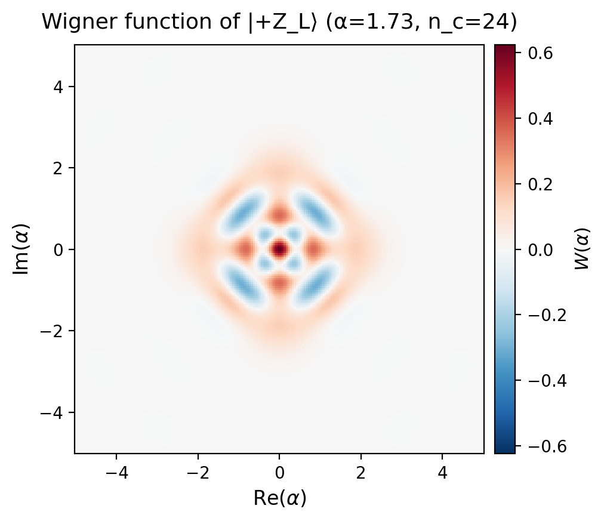
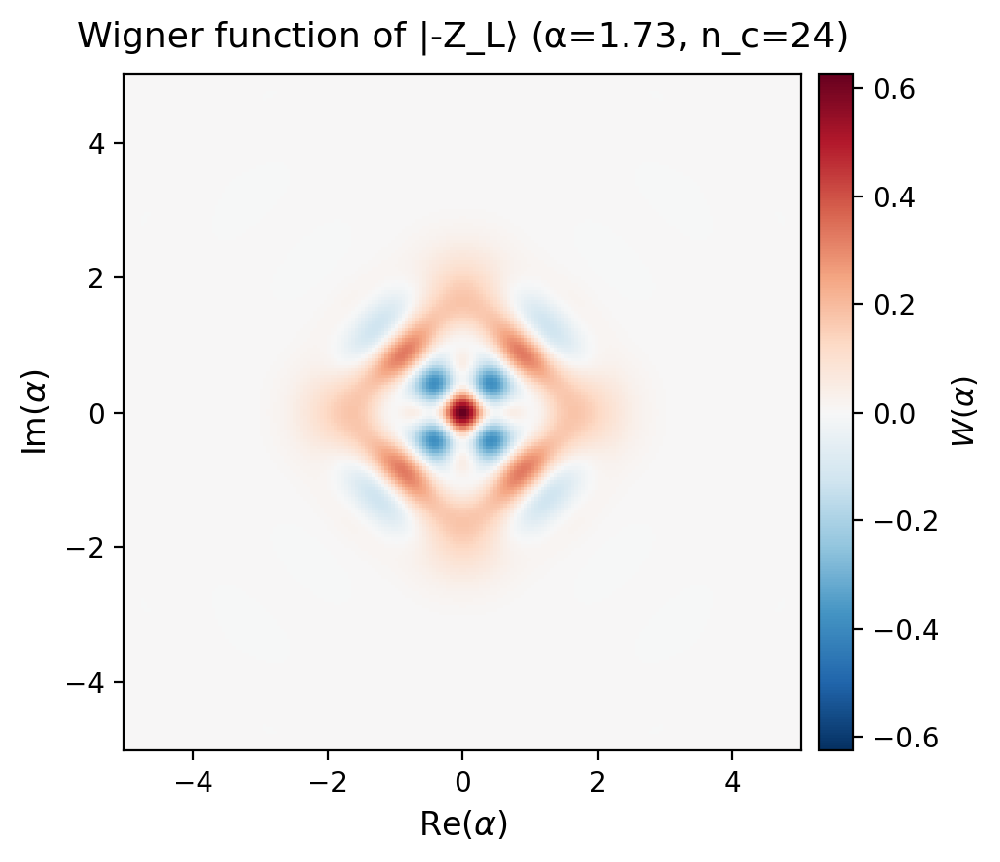
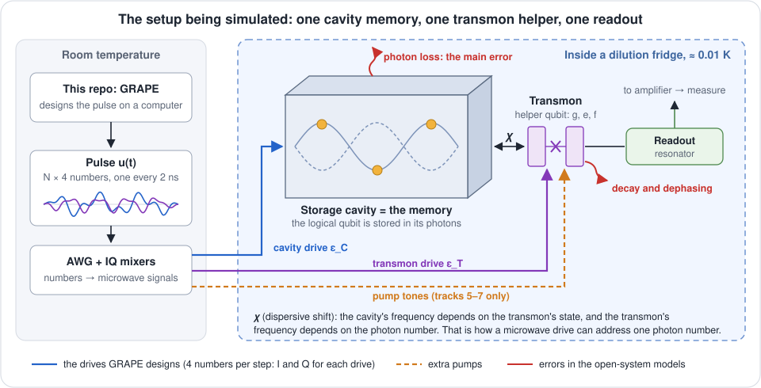
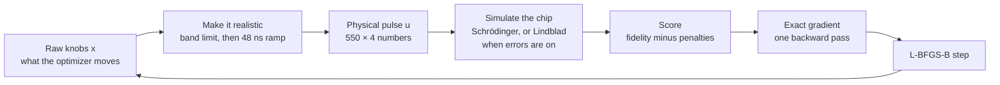
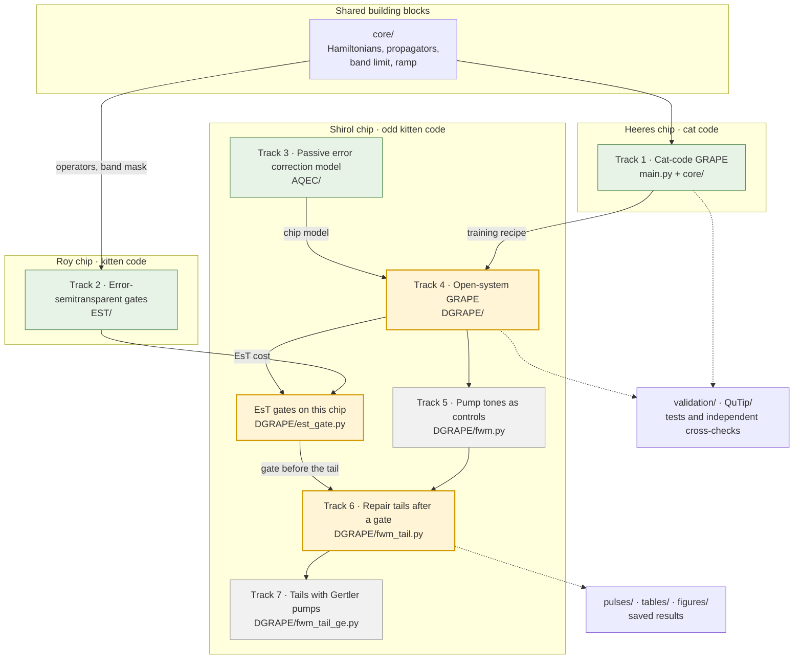

# Qubit-Drive-GRAPE

This repository uses a computer to **design the microwave pulses that control a quantum memory**. The memory
is a superconducting microwave box (a *cavity*) that stores one qubit in its photons. A small helper circuit
(a *transmon*) lets us steer it. Each pulse is about one microsecond of carefully shaped microwaves. It
prepares the stored qubit, runs a logical gate on it (X, Y, Z, H, T), or repairs damage after a photon leaks
out.

The pulses are found with **GRAPE** (Gradient Ascent Pulse Engineering), a form of *optimal control*: we
simulate the chip, score how well a trial pulse works, and improve the pulse step by step. Nothing here runs on
real hardware. Everything is a careful simulation of three published chips.

**How to read this page.** Sections 1–3 explain the physics and the layout of the repository in plain
language. Section 4 says what is being worked on now. Section 5 shows how to run things. Section 6 is the
technical reference for the main (cat-code) pipeline, and there is a glossary at the end.

- [1. The physics in three ideas](#1-the-physics-in-three-ideas)
- [2. Map of the repository](#2-map-of-the-repository)
- [3. The seven tracks](#3-the-seven-tracks)
- [4. What we are working on now](#4-what-we-are-working-on-now)
- [5. Quick start](#5-quick-start)
- [6. Cat-code pipeline: technical reference](#6-cat-code-pipeline-technical-reference)
- [Glossary](#glossary) · [References](#references)

---

## 1. The physics in three ideas

### 1.1 Bosonic qubits: storing a qubit in a box of photons

A normal superconducting qubit (a transmon) has two levels we care about, $|g\rangle$ and $|e\rangle$. A
microwave **cavity** is different. It is a harmonic oscillator, like a guitar string, so it can hold
0, 1, 2, 3, … photons. Each photon number is a level, called a *Fock state* $|n\rangle$. A qubit stored in
such an oscillator is a **bosonic qubit**.

Why bother with all those extra levels?

- **Cavities are quiet.** They keep photons for hundreds of microseconds or longer, which is longer than most
  transmons keep their state.
- **They mostly fail in one way: a photon leaks out.** With only one main error type, we can pick the two
  logical states (the *code words*) so that a lost photon can be **detected and fixed** instead of
  destroying the information.

The trick is **parity**, meaning whether the photon number is even or odd. If both code words use only even
photon numbers, then losing one photon makes the number odd. You can measure that without learning (and so
destroying) which code word you had.

This repository uses three such codes:

| Code | Logical 0 | Logical 1 | Used in |
|------|-----------|-----------|---------|
| **Four-component cat** (Heeres 2017), amplitude $\alpha=\sqrt3$ | photons 0, 4, 8, … | photons 2, 6, 10, … | Track 1 |
| **Binomial "kitten"** (Roy 2026) | $(\lvert0\rangle+\lvert4\rangle)/\sqrt2$ | $\lvert2\rangle$ | Track 2 |
| **Odd kitten** (Shirol 2026) | $(\lvert1\rangle+\lvert5\rangle)/\sqrt2$ | $\lvert3\rangle$ | Tracks 3–7 |

<p align="center">
  
  
</p>

*The two cat-code words drawn as Wigner functions, a "map" of the cavity's state. The axes are the two
quadratures of the field (think position and momentum of the oscillator). The blue regions are negative.
That cannot happen for any classical state, so it shows the state is truly quantum.*

### 1.2 The setup being simulated

<p align="center"></p>

The parts, from left to right:

- **The computer (this repo)** designs a pulse: a table of numbers, one row every 2 ns, four columns
  (the in-phase *I* and quadrature *Q* parts of two drives). A typical gate is 550 rows, about 1.1 μs.
- **The AWG** (arbitrary waveform generator) and IQ mixers turn those numbers into real microwave signals.
- **The cavity drive** $\varepsilon_C$ pushes photons into, or out of, the storage cavity.
- **The transmon drive** $\varepsilon_T$ flips the transmon between its levels $|g\rangle$, $|e\rangle$, $|f\rangle$.
- **The storage cavity** holds the qubit. On its own it is *linear*: a drive can only shift its state
  around, it cannot build a cat state.
- **The transmon** is the *nonlinear* helper that makes everything else possible. Its link to the cavity is the
  **dispersive shift χ**: the cavity's frequency depends on whether the transmon is in $|g\rangle$ or $|e\rangle$,
  and the transmon's frequency depends on how many photons are in the cavity. A drive tuned to one
  frequency therefore acts only when the cavity holds a particular photon number. That selectivity is the
  "handle" GRAPE pulls on.
- **The readout resonator** is used to measure the transmon. In tracks 5–7 it also serves as a drain that
  carries entropy away during error correction.
- **Pump tones** (dashed, tracks 5–7 only) are extra strong drives that mix modes together. They can put a lost
  photon back (Section 3).
- **Errors** (red). Photon loss from the cavity, and decay and dephasing of the transmon. Track 1 trains
  without them (a *closed*, perfect system). Tracks 3–7 simulate them exactly (an *open* system).

Three chips appear in this repository. They are different devices from different papers, and each has its own parameter file:

| Chip | Paper | χ/2π (cavity–transmon) | Code | Tracks | Parameters in |
|------|-------|------------------------|------|--------|---------------|
| Heeres | Heeres *et al.*, Nat. Commun. 2017 | −2.194 MHz | four-component cat | 1 | `core/grape_core.py` (top) |
| Roy | Roy, Wetherbee & Fatemi, 2026 | −3.66 MHz | kitten | 2 | `EST/device.py` |
| Shirol | Shirol *et al.*, PRX 2026 | 1.12 MHz (stored positive) | odd kitten | 3–7 | `AQEC/device.py` |

> **Sign warning.** `AQEC/device.py` follows Shirol and stores χ and the anharmonicity as *positive* numbers with
> explicit minus signs in the Hamiltonian. The other two chips store signed values. Never mix them without
> flipping signs.

### 1.3 GRAPE: tuning a pulse by following the slope

Picture a mixing desk with about 2 200 knobs: 550 time steps times 4 drive values. Every setting of the knobs
is a pulse. For any pulse we can simulate the chip and get a **score**, the *fidelity*, from 0 (useless) to
1 (perfect). The goal is to find the knob setting with the highest score.

Turning one knob at a time would take forever. GRAPE instead computes the **gradient**, which says how much
the score changes if each knob is nudged, all at once. It uses the *adjoint method*: one simulation forward in
time and one backward in time give the slope for every knob at the cost of about two simulations. An
optimizer (L-BFGS-B, a standard quasi-Newton method) then takes a step uphill, and the loop repeats a few
hundred to a few thousand times.



Why not design the pulse by hand? The transmon–cavity system is nonlinear and has dozens of levels in play. For a
task like "turn the vacuum into a cat state" there is no textbook pulse. A numerical search is the
practical way.

A pulse that scores well in a simulation is useless if real hardware cannot play it. So every pulse here must
obey four **realism rules**:

1. **Limited bandwidth.** Real electronics and filters pass only a range of frequencies, so the pulse is
   projected onto an allowed frequency band (±27 MHz cavity, ±33 MHz transmon).
2. **Start and end at zero.** A 48 ns smooth rise and fall is built into the pulse.
3. **An amplitude cap.** No drive may exceed 25 rad/μs.
4. **Do not cheat the cutoff.** A computer can only simulate a finite number of photon levels (the
   *truncation* $n_c$). An optimizer can learn to exploit that artificial "wall". So pulses are trained at
   several truncations at once and checked at larger ones they never saw.

Two more ideas appear throughout:

- **Closed vs open system.** In a *closed* simulation nothing is lost. The state is a vector and evolves by the
  Schrödinger equation. In an *open* simulation photons leak and the transmon decays. The state becomes a
  density matrix and evolves by the Lindblad *master equation*. Open simulations are more realistic and
  more expensive: a state of *d* numbers becomes a *d* × *d* matrix.
- **Error transparency.** An ordinary gate only promises the right answer at the end, if nothing went wrong. If a
  photon leaks out halfway through, the rest of the pulse can scramble the damaged state beyond repair. An
  *error-(semi)transparent* gate is trained so that it still acts sensibly on the damaged state. A photon lost
  mid-gate then remains fixable afterwards.

---

## 2. Map of the repository



*Yellow = active now, green = finished, grey = finished with a negative ("null") result.*

**Folders**

| Folder | What is in it |
|--------|---------------|
| `core/` | The GRAPE engine for track 1: Hamiltonian, propagators, fidelity and gradient, band limit (`fourier_cutoff.py`), ramp (`ramp.py`), cat code (`cat_code.py`), optimizer |
| `EST/` | Track 2: error-semitransparent gates on the Roy chip, with JAX gradients. Has its own [`EST/README.md`](EST/README.md) |
| `AQEC/` | Track 3: the Shirol chip (`device.py`), its master equation, the odd kitten code, Wigner functions |
| `DGRAPE/` | Tracks 4–7: exact open-system GRAPE, pump tones, repair tails, and their training and scoring scripts |
| `validation/` | Unit tests for every track, plus the five-tier validation suite for track 1 |
| `QuTip/` | An independent re-implementation of track 1's physics in QuTiP, used as a cross-check |
| `analysis/`, `visualization/` | One-off analysis scripts (penalty sweep, decoherence, rescoring) and plotting helpers |
| `pulses/` | Saved pulses (`u_*.npy`, shape (N, 4)). `pulses/u_*_main.npy` are track 1's production gates. `pulses/est/` and `pulses/dgrape/` hold the other tracks' pulses |
| `tables/`, `figures/`, `wigner/`, `results/`, `logs/` | Generated output. Regenerate it with a script; do not edit it by hand |
| `slides/` | LaTeX slides and notes on the EsT theory |
| `sources/` | The papers (local only, not committed) |

---

## 3. The seven tracks

| # | Question in plain words | Code | Notebook | Status |
|---|-------------------------|------|----------|--------|
| 1 | Can GRAPE build a full gate set on a cat-code qubit, under realistic pulse limits? | `core/`, `main.py` | `experiments.ipynb`, `penalty_optimization.ipynb` | Done. Gate fidelities 0.998–0.9998 |
| 2 | Can we reproduce gates that stay correctable when a photon is lost mid-gate? | `EST/` | `est_experiments.ipynb`, `est_optimization.ipynb` | Replication done |
| 3 | How does Shirol's passive error correction work, step by step? | `AQEC/` | `aqec_experiments.ipynb`, `fwm_tuning.ipynb` | Done. Reproduces PRX Fig. 2 |
| 4 | What is the best gate when photon loss and decay are in the training itself? | `DGRAPE/` | `dissipation_grape.ipynb` | **Active** |
| 5 | If the pump tones are extra GRAPE knobs, do they help a gate? | `DGRAPE/fwm.py` | `fwm_grape.ipynb` | Null result. The optimizer switches them off |
| 6 | Can a short pump "tail" after a gate repair the photons the gate lost? | `DGRAPE/fwm_tail.py`, `DGRAPE/est_gate.py` | `FWM_tails.ipynb`, `est_gate_selection.ipynb` | **Active** |
| 7 | Do the pumps of Gertler 2021 work better as a tail? On any realistic chip? | `DGRAPE/fwm_tail_ge.py`, `DGRAPE/ge_chip.py` | `FWM_tails_ge.ipynb` | No-go. Stopped 2026-11-05 |

How they connect: track 1 built the GRAPE machinery and the pulse rules. Track 2 added the idea of error
transparency. Track 3 built a faithful model of a chip that can correct its own photon loss. Tracks 4–7 put the
three together: they design gates on that chip with errors on, and ask whether pumping can win back what
the gate loses.

---

## 4. What we are working on now

*Status as of November 2026. The full record, with dates and decisions, is in `CLAUDE.md` and in each notebook.*

The main score below is **F_pro**, the *process fidelity* of an X gate in the open (noisy) simulation of the
Shirol chip: how close the real, noisy operation is to a perfect X, where 1 is perfect. For scale,
**d2** is our reference gate. It was trained with the noise model on and scores **F_pro = 0.9556**.

### Error-semitransparent gates on the Shirol chip

*Question:* do track 2's transparent gates carry over to this chip, and do they help later repair?
`DGRAPE/est_gate.py` trains them with track 2's cost unchanged, in the closed system.

- **X gate.** 50 random starts were trained and ranked by a rule fixed before training. **Seed 24 is the pick**
  (`pulses/dgrape/u_X_est_err_closed_s24.npy`). It scores F_pro ≈ 0.968 in the noisy simulation, and an
  ideal repair after it gains about +2 % (vs +0.96 % after d2).
- **H gate.** At 1.1 μs no start met the bars. On this chip χ is three times smaller than on the Roy chip, so
  1.1 μs is too short for transparency. At **2 μs, seed 17 is the pick** (F_pro 0.950). Seed 27 is a
  close second that repairs better.
- **Next:** a cost term that rewards transparency *during* the whole gate, not only at the end. More seeds
  will not help.
- Notebooks: `est_gate_selection.ipynb`, `FWM_tails.ipynb` §3.

### Open-system GRAPE (track 4)

*Question:* how good can an X gate get when the training sees the exact noisy dynamics?
`DGRAPE/lindblad_np.py` gives the exact gradient of the noisy process fidelity (checked three independent
ways to 1e-13).

- **Best so far: F_pro 0.9589** (`X_open_d3b`). It adds a penalty for time spent in the excited transmon
  states, which cut transmon-decay losses by about a third.
- One truncation ($n_c = 16$) turned out to be enough, which saves time.
- What is left: **dephasing (~1.05 %)** is now the largest loss, and training has not seen it yet.
- **Next:** train with `--dephasing`. Resume `d3b`, which had not finished converging (`--init-x`).
- Notebook: `dissipation_grape.ipynb` §10–§12.

### Repair tails after a gate (track 6)

*Idea:* after the gate, play a short "tail" of Shirol's two pump combs. The first comb puts a lost photon back
while lifting the transmon to $|f\rangle$. The second returns the transmon to $|g\rangle$ and dumps the
excitation into the readout resonator, which carries it away. GRAPE shapes the two combs.

- **One go, at the bar:** EsT gate + 0.8 μs tail **gains +0.32 %** over the gate alone (0.97027 vs
  0.96706). The bar of +0.3 % was set before training. d2 and ordinary gates *lose* with a tail.
- The repair is real (no gain in a loss-free simulation; photon-loss cost 2.38 → 1.85 % at 1 μs), but it is **fragile**: the
  pump strength off by 10 % costs 10–13 %.
- **Repeated gates:** 20 gate + tail pairs end at 0.642, against 0.520 for 20 bare gates back to back.
- **Is the tail itself transparent?** Partly. A photon lost late in the tail stays fixable. A transmon
  f → e decay during the tail does not.
- **Next:** a faster repair "shot", training that is robust to pump strength, and a gate trained to make
  its losses repairable.
- Notebook: `FWM_tails.ipynb` §6 (results), §8 (repeated gates), §9 (transparency).

**Recently closed:** track 5 (pump tones as gate knobs: null), track 7 (Gertler pumps and a 36-chip
search: no realistic chip clears +0.3 %).

---

## 5. Quick start

```bash
pip3 install -r requirements.txt     # numpy, scipy, joblib, matplotlib, pandas, jax
pip3 install qutip                   # only for the QuTip/ cross-check
```

Run everything from the repository root, with `python3`. There is no build step, and the tests are plain
`unittest` files.

**Train one track-1 gate** (about an hour; the defaults are the production recipe, Section 6.7):

```bash
python3 main.py --gate X --seed 43       # seeds are per gate: enc 47, dec 43, X 43, Y 46, Z/H/T/I 42
```

**Tests, one row per track**

| Track | Command | Time |
|-------|---------|------|
| 1 | `python3 validation/test_grape_core_perf.py -v` · `python3 validation/test_phase0.py -v` | |
| 2 | `python3 EST/test_grape_jax.py -v` | |
| 3 | `python3 validation/test_aqec_master_equation.py -v` · `python3 validation/test_aqec_wigner.py -v` | ~1 min |
| 4 | `python3 validation/test_dgrape.py -v` | ~4 min |
| 5 | `python3 validation/test_fwm_grape.py -v` | ~1.5 min |
| 6 | `python3 validation/test_fwm_tail.py -v` · `validation/test_est_gate.py` · `validation/test_fwm_repeat.py` | ~2 min |
| 7 | `python3 validation/test_fwm_tail_ge.py -v` · `validation/test_fwm_tail_ge_chip.py` | ~15 s |

**Track 1 checks on the saved pulses**

```bash
python3 validation/validate_logical_gates.py     # five-tier suite, Section 6.6
python3 validation/truncation_convergence.py     # fidelity vs photon cutoff
python3 QuTip/qutip_validate.py                  # independent QuTiP cross-check
```

**Look at a pulse**

```python
import numpy as np
from visualization.pulse_viz import plot_pulse_waveforms, plot_pulse_spectrum
from visualization.wigner_viz import plot_wigner_from_pulse

u = np.load("pulses/u_enc_main.npy")
plot_pulse_waveforms(u, title="U_enc")
plot_pulse_spectrum(u, title="U_enc spectrum")
# encode maps |g,0> -> +Z_L and |e,0> -> -Z_L
plot_wigner_from_pulse("pulses/u_enc_main.npy", initial_state="vacuum", transmon="g", title="+Z_L after encoding")
```

---

## 6. Cat-code pipeline: technical reference

This section is the reference for track 1 (`core/`, `main.py`). Read it before changing `core/grape_core.py`,
`core/optimizer.py` or `core/cat_code.py`. The history behind each choice (retrain campaigns, before/after
tables, benchmarks) lives in `experiments.ipynb` §5–6 and in git history.

### 6.1 Model

Transmon (operator $B$, $n_t$ levels) times cavity (operator $A$, $n_c$ levels), in a rotating frame. The
**drift** Hamiltonian, with lab parameters in MHz converted to rad/μs:

$$
H_0 = \chi\, n_A n_B + \frac{K}{2}\, A^{\dagger 2} A^2 + \frac{\chi'}{2}\, n_B\, A^{\dagger 2} A^2 + \frac{\alpha}{2}\, B^{\dagger 2} B^2
$$

| Term | Meaning | Value (/2π) |
|------|---------|-------------|
| $\chi\, n_A n_B$ | dispersive shift: cavity frequency depends on the transmon state | −2.194 MHz |
| $K\, A^{\dagger 2}A^2$ | cavity self-Kerr: the cavity is slightly nonlinear | −0.0037 MHz |
| $\chi'\, n_B A^{\dagger 2}A^2$ | second-order dispersive shift | −0.019 MHz |
| $\alpha\, B^{\dagger 2}B^2$ | transmon anharmonicity (only for $n_t \ge 3$) | −236 MHz |

The **control** Hamiltonian has four real drives per time step:

$$
H_c = \varepsilon_{C,I}(A+A^\dagger) + \varepsilon_{C,Q}\, i(A-A^\dagger) + \varepsilon_{T,I}(B+B^\dagger) + \varepsilon_{T,Q}\, i(B-B^\dagger)
$$

At step $k$, $H_k = H_0 + \sum_j u_{k,j} H_{c,j}$, with $dt = 2$ ns and $N = 550$ steps (1.1 μs). Pulses are
stored as `(N, 4)` arrays: cavity I, cavity Q, transmon I, transmon Q. Use $n_t = 3$ when transmon leakage
matters, and $n_c$ 20–28 for training (validated to 32). The parameters live at the top of `core/grape_core.py`. **Never change
them for other chips**: every saved pulse is scored against them.

### 6.2 Cat code

Code words of the even four-component cat with $\alpha = \sqrt3$: $|{+Z_L}\rangle$ on photons 0, 4, 8, … and
$|{-Z_L}\rangle$ on 2, 6, 10, …. **Encode** maps $|g,0\rangle \to |g\rangle|{+Z_L}\rangle$ and
$|e,0\rangle \to |g\rangle|{-Z_L}\rangle$. **Decode** is the inverse. The logical gates (X, Y, Z, H, T, I) act on
the cat code words with the transmon in $|g\rangle$ before and after. New gates follow the pattern in
`core/cat_code.py` and are registered in `main.py`'s `GATE_FACTORIES` and in
`validation/validate_logical_gates.py`'s `GATE_PULSE_MAP`.

### 6.3 The score: a phase-coherent fidelity

Every gate is trained on two input/target pairs at once. Averaging the two separate fidelities
(`fidelity_multi_state`) is blind to the *relative phase* between the branches, and that phase is exactly
what a gate on a superposition depends on. Production therefore trains with the **coherent** fidelity:

$$
F_{\rm coh} = \Bigl|\sum_m \langle f_m | U | i_m \rangle\Bigr|^2 / M^2
$$

`coherent_fidelity_multi_state` adds the complex overlaps *before* squaring, so it is maximal only when every
branch is right under the same global phase (`main.py --fidelity-fn auto`). Pair it with
`make_coherent_gate_factory`. In the past, phase-blind training gave pulses that scored 0.996 per branch but only
0.34–0.98 as gates. `tier3_gate_algebra` and `tier4_enc_dec_relative_phase` now catch that.

On the current `pulses/u_*_main.npy`: 2×2 gate fidelity `F_avg_gate` **0.99787 (dec) – 0.99979 (T)**, and
encode → gate → decode `Pipeline_avg` **0.99537 (H) – 0.99764 (T)**.

### 6.4 Gradients

The **adjoint (costate) method**:

1. **Forward:** propagate $|\phi_k\rangle = U_k \cdots U_1 |i\rangle$, keeping each step's eigendecomposition.
2. **Backward:** propagate $\langle\lambda_k| = \langle f| U_N^\dagger \cdots U_k^\dagger$.
3. **Per step:** $\partial U_k/\partial u_j = V(\Phi \circ V^\dagger H_{c,j} V)V^\dagger$, where $\Phi$ handles
   nearly equal eigenvalues.

Propagators come from eigendecomposition, $U_k = V\,\mathrm{diag}(e^{-i\,dt\,\omega})V^\dagger$, not from a
matrix exponential. `_fidelity_core` diagonalizes once per step and propagates all target states together.
It is the shared kernel behind `fidelity_grad` and `fidelity_multi_state`. Those signatures are a stable
interface, guarded by `validation/test_grape_core_perf.py`: equivalence with the old code, a finite-difference
check, and smoke tests.

### 6.5 Pulse constraints

The optimizer moves a raw variable $x$. The physical pulse is

$$
u = R\,P(x), \qquad \frac{\partial\,\mathrm{cost}}{\partial x} = P\bigl(\mathrm{env}\odot \tfrac{\partial\,\mathrm{cost}}{\partial u}\bigr)
$$

- **$P$, band limit** (`core/fourier_cutoff.py`, Heeres Supp. Eq. 22): FFT, keep the allowed band, inverse
  FFT, applied separately to each complex drive. It is an exact projection, so the same $P$ acts on the
  gradient. It is off unless `cav_band`/`tra_band` are given (both or neither). Production uses ±27 / ±33 MHz.
- **$R$, ramp** (`core/ramp.py`): a 48 ns Gaussian rise and fall, exactly 0 at the ends and 1 on the flat top.
  It replaced an endpoint penalty that did not work (`penalties={'boundary': …}` now raises). The order matters:
  the envelope multiplies the gradient *before* the projection. The reversed order also gives a
  plausible-looking gradient, so a test with a negative control pins it. Ramping after the band limit leaves
  sub-percent out-of-band energy. That is accepted, because projecting last would leave the endpoints at about
  32 % amplitude.
- **Where the ramp default is ON:** the `core/optimizer.py` entry points (`ramp_ns=48`). **Where it is OFF:**
  `make_constraint_chain` and the three legacy makers in `grape_core.py`, which therefore give *unramped*
  pulses without warning. `ramp_ns=0` (`main.py --ramp-ns 0`) disables it, for pulses too short for a flat top.
- **Amplitude penalty** (Heeres Supp. Eq. 19): it charges the drive modulus $|\varepsilon| = \sqrt{I^2+Q^2}$
  above `amp_max` = 25 rad/μs (`amp_norm="modulus"`). The library default `"quadrature"` charges each column
  separately.
- **Hard box** `hard_amp_limit`: a per-element bound on $x$, *not* on $|\varepsilon|$. It is what stops the
  optimizer from inflating $x$ near the ends to win back what the ramp takes away. Raising it quietly undoes
  part of the ramp. Mind the library defaults: 50 in `optimize_multi_state_pulse`, 40 in `refine_pulse*`,
  25 in production.

**At 25 the box binds, so seeds are chosen per gate:**

| | enc | dec | X | Y | Z | H | T | I |
|---|---|---|---|---|---|---|---|---|
| seed | 47 | 43 | 43 | 46 | 42 | 42 | 42 | 42 |
| $\max\lvert x\rvert$ | **25.00** | 20.36 | 23.58 | **25.00** | 22.71 | 24.72 | 6.32 | 5.42 |
| entries at the bound | 0.41 % | 0 | 0 | 0.045 % | 0 | 0 | 0 | 0 |

Y is the fragile one: at seed 42 it pins 4.86 % of its entries and drops to F = 0.899. Encode is clipped at
every seed, and seed 47 is kept on purpose as the best encode pulse. **After any retrain check two numbers:**
`info['max_drive_modulus']` against `amp_max`, the physical limit, and `info['max_abs_preimage']` against
`hard_amp_limit`. A pulse sitting at the bound was clipped, not converged, so read its held-out fidelity.

**Saved pre-images.** Every `pulses/u_<gate>_main.npy` comes with its raw `x_<gate>_main.npy`. Only $u$ is
physical and scored. $x$ is there so a run can resume *exactly* with `init_x`. Prefer that to `warm_start`,
which has to invert the chain (`core.ramp.deramp`) and refuses pulses made before the ramp existed unless you
pass `warm_start_strict=False`.

### 6.6 Truncation, validation and noise

**Do not exploit the photon cutoff.** Heeres Supp. Note 2: train on several truncations at once, using their
average fidelity (Eq. 23) plus a penalty on their disagreement $\sum_{k_1\ne k_2}(F_{k_1}-F_{k_2})^2$
(Eq. 24, `penalties['disc']`). Start from a **random (cold) start**. Then check that fidelity stays flat at
truncations *above* the trained ones (`validate_pulse_truncations`, `validation/truncation_convergence.py`).
Warm-starting from a pulse that already exploits the wall stays in that bad solution. A dip *below* the trained
range (Y at $n_c = 18$) is fine: it only means the pulse needs that many levels.

**Five-tier validation** (`validation/validate_logical_gates.py`):

1. fidelity vs truncation;
2. logical action and leakage out of the code;
3. gate algebra ($X^2 \approx I$, $H^2 \approx I$, T's phase);
4. the encode → gate → decode pipeline;
5. the extracted 2×2 unitary vs the ideal one (`core/propagator.py`).

**Independent cross-check.** `QuTip/qutip_validate.py` rebuilds the physics in QuTiP without importing
`core/` and evolves each pulse with `qutip.sesolve`. Agreement to about 1e-5 shows the model is right, not just
self-consistent.

**Noise estimate.** `analysis/decoherence.py` re-runs a pulse under the Lindblad equation with cavity decay,
transmon decay and transmon dephasing (rates from $T_1^C$, $T_1^T$, $T_\phi$ in seconds):

```python
from core.grape_core import basis_state
from analysis.decoherence import simulate_with_decoherence, compute_fidelity
import numpy as np

u = np.load("pulses/u_opt_main.npy")
psi0 = basis_state(n_t=3, n_c=24, t_level=0, c_level=0)        # |g,0>
target = basis_state(n_t=3, n_c=24, t_level=0, c_level=6)      # |g,6>
print(compute_fidelity(simulate_with_decoherence(u, psi0), target))
```

### 6.7 Production recipe

`main.py`'s CLI defaults *are* the recipe. `experiments.ipynb`'s `OPTIMIZATION_RECIPE` and
`analysis/penalty_sweep.py`'s `FIXED` mirror it. Many values differ from the library defaults of
`optimize_multi_state_pulse`:

| Parameter | Production | Library default |
|-----------|------------|-----------------|
| `trunc_list` | [22, 24, 26] | [20, 24, 28] |
| `maxiter` | 1500 | 2000 |
| `ramp_ns` | 48 ns | 48 ns (but `None` on `make_constraint_chain`) |
| `hard_amp_limit` | 25 | 50 (`refine_pulse*`: 40) |
| `amp_max` / `amp_norm` | 25 / `modulus` | 40 / `quadrature` |
| `deriv` · `amp` · `disc` | 1e-5 · 8e-5 · 0.5 | 1e-5 · 1.2e-4 · 0 |
| `cav_band` / `tra_band` | ±27 / ±33 MHz | off |
| seed | per gate (table above); `main.py` default is 42 | 42 |
| `fidelity_fn` | `coherent_fidelity_multi_state` | `fidelity_multi_state` |

The same run from Python:

```python
from core.cat_code import make_coherent_gate_factory, validate_pulse_truncations
from core.grape_core import coherent_fidelity_multi_state
from core.optimizer import optimize_multi_state_pulse

get_X_pairs = make_coherent_gate_factory("X")   # pairs from IDEAL_LOGICAL_U; matches the coherent fidelity

u_X, info = optimize_multi_state_pulse(
    get_state_pairs=get_X_pairs,
    trunc_list=[22, 24, 26],
    penalties={"deriv": 1e-5, "amp": 8e-5, "amp_max": 25.0, "disc": 0.5},
    amp_norm="modulus",
    warm_start=None, warm_start_seed=43,         # cold start, X's seed
    cav_band=(-27.0, 27.0), tra_band=(-33.0, 33.0),
    ramp_ns=48.0, hard_amp_limit=25.0,
    n_jobs=3, maxiter=1500,
    fidelity_fn=coherent_fidelity_multi_state,
    save_path="pulses/u_X_logical_v1.npy",
)
assert info["max_abs_preimage"] < 25.0                           # not clipped
assert max(info["max_drive_modulus"].values()) <= 25.0 * 1.01    # amplitude limit honoured
validate_pulse_truncations(u_X, get_X_pairs)
```

The penalty-weight sweep (`analysis/penalty_sweep.py`) has its own rules for caches and tags. Read
`.claude/skills/penalty-sweep/SKILL.md` before running it.

---

## Glossary

| Term | Meaning |
|------|---------|
| **Fock state** $\lvert n\rangle$ | The cavity holding exactly *n* photons |
| **Transmon** | A superconducting circuit with unevenly spaced levels $g, e, f$. Here it is the nonlinear helper, not the memory |
| **Dispersive shift χ** | How much the cavity's frequency moves when the transmon is excited (and vice versa) |
| **Kerr** | A small nonlinearity of the cavity itself. It slowly twists the phase of states with many photons |
| **Logical qubit / code words** | The qubit we care about, stored as two chosen cavity states (logical 0 and 1) |
| **Parity** | Whether the photon number is even or odd. A lost photon flips it |
| **Fidelity** | How close a result is to the target, from 0 to 1. *F1*: closed-system gate fidelity. *F_pro*: process fidelity with noise. *F_avg_gate*: average 2×2 gate fidelity |
| **Truncation $n_c$** | How many photon levels the simulation keeps. A good pulse must not depend on it |
| **Closed / open system** | Without / with losses. Open means a density matrix and the Lindblad master equation |
| **Pre-image $x$** | The raw variable the optimizer moves. The physical pulse is $u = R\,P(x)$ |
| **EsT (error-semitransparent)** | A gate that keeps a mid-gate photon loss correctable |
| **Kitten code** | A small binomial code using only a few photons (here, up to 4 or 5) |
| **FWM / pump tone** | Four-wave mixing: a strong drive that makes two modes swap energy, for example adding a photon to the cavity while exciting the transmon |
| **PReSPA** | Shirol's passive correction scheme: two FWM combs that put back a lost photon and dump the entropy into the readout |
| **Tail** | A short pump pulse played right after a gate to repair it (track 6) |

## References

- R. W. Heeres *et al.*, "Implementing a universal gate set on a logical qubit encoded in an oscillator,"
  *Nat. Commun.* **8**, 94 (2017). [doi:10.1038/s41467-017-00045-1](https://www.nature.com/articles/s41467-017-00045-1). **Track 1's main reference.**
- Roy, Wetherbee & Fatemi, "Error semitransparent universal control of a bosonic logical qubit,"
  [arXiv:2603.15356](https://arxiv.org/abs/2603.15356). Track 2.
- Shirol *et al.*, "Passive quantum error correction of photon loss at breakeven," *Phys. Rev. X* **16**,
  021042 (2026). Tracks 3–7.
- Gertler *et al.*, "Protecting a bosonic qubit with autonomous quantum error correction,"
  *Nature* **590**, 243 (2021). Track 7.
- N. Khaneja *et al.*, "Optimal control of coupled spin dynamics: design of NMR pulse sequences by gradient
  ascent algorithms," *J. Magn. Reson.* **172**, 296 (2005). [doi:10.1016/j.jmr.2004.11.004](https://doi.org/10.1016/j.jmr.2004.11.004). The original GRAPE paper.
- A. Blais *et al.*, "Cavity quantum electrodynamics for superconducting electrical circuits,"
  *Phys. Rev. A* **69**, 062320 (2004). [arXiv:cond-mat/0402216](https://arxiv.org/abs/cond-mat/0402216). Background on circuit QED.
